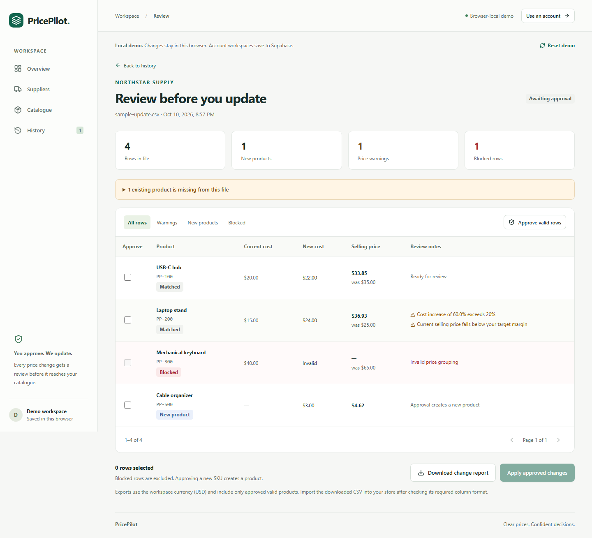
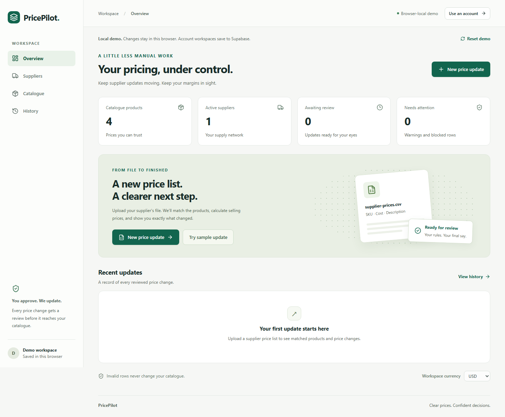
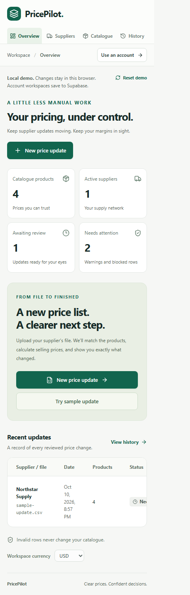
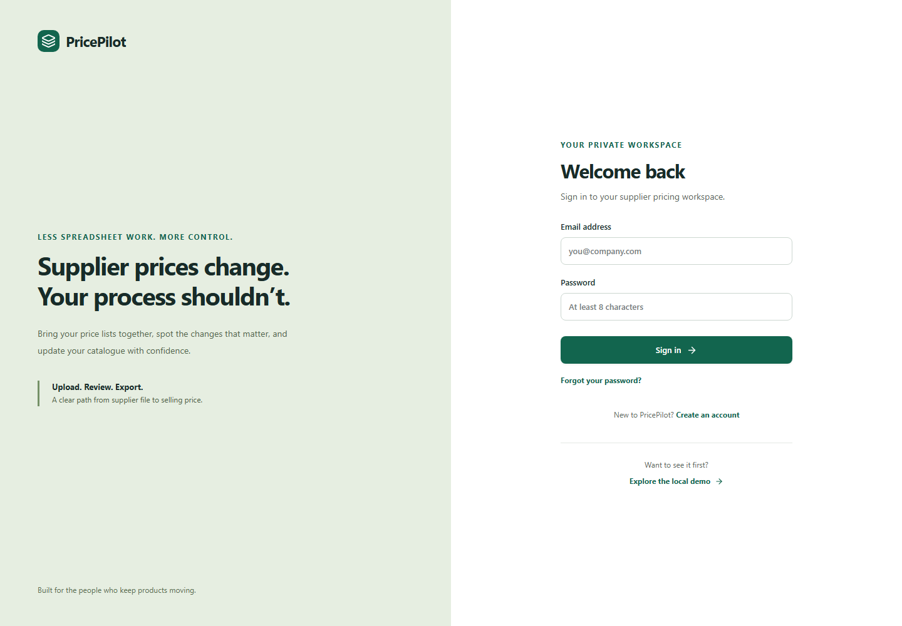

# PricePilot

**Turn supplier price lists into reviewed product price updates.** Upload a supplier's CSV or Excel file, map its columns and match it against your catalogue. Then review the cost changes and suggested selling prices, approve what you want and export the result.



> **Status:** feature-complete local build, verified end to end against a local Supabase stack. It is not deployed publicly.

## How it works

1. **Set up a supplier** with pricing rules: a target gross margin or cost markup, a cost-increase alert threshold and optional SKU aliases.
2. **Import your catalogue.** Columns can have any names because you map them in the UI.
3. **Upload the supplier's latest price list** (CSV or XLSX). Pick the sheet, map SKU/name/cost and choose the decimal separator.
4. **Review** every row: matched products, new SKUs, price warnings, blocked rows and catalogue products missing from the file.
5. **Approve** the rows you want and **apply** them in one atomic update.
6. **Export** a product CSV (`sku,name,cost,selling_price`) and a full change report.

## Features

- Accounts with sign-up, sign-in, password reset and password change; private workspaces protected by row-level security.
- CSV and XLSX parsing **in the browser**. Original supplier files are never uploaded or stored, and only the mapped columns reach the server.
- Handles quoted CSV, semicolon delimiters, BOMs, comma or period decimals, multi-sheet workbooks (invalid sheets are skipped with visible notices) and leading-zero SKUs.
- Exact SKU matching plus explicit aliases. Unknown SKUs need explicit approval as new products, and missing products are never deleted automatically.
- Blocks duplicate SKUs, alias collisions, missing identifiers and invalid or formula-based costs. Formulas are never evaluated.
- Margin warnings, a cost-increase alert and selling prices calculated with decimal arithmetic.
- Stale-review and repeat-apply protection, plus a saved history of updates.
- CSV exports with spreadsheet-formula escaping to prevent CSV injection.
- Supports USD, EUR, GBP, PKR, CAD and AUD.
- Responsive, keyboard-operable UI with labelled controls. Automated WCAG A/AA scans report no violations.
- A browser-local **demo workspace** at `/demo` with sample data.

## Screenshots

| Overview                                   | Mobile                                 | Sign in                                |
| ------------------------------------------ | -------------------------------------- | -------------------------------------- |
|  |  |  |

## Tech stack

| Layer   | Tools                                                                                  |
| ------- | -------------------------------------------------------------------------------------- |
| App     | Next.js 16 (App Router, server actions), React, TypeScript                             |
| Backend | Supabase: Postgres with row-level security and Auth                                    |
| Data    | decimal.js for money, ExcelJS and PapaParse for in-browser parsing, Zod for validation |
| Testing | Vitest (unit + integration), Playwright, axe-core accessibility scans                  |
| Tooling | ESLint, Prettier, GitHub Actions CI                                                    |

## Architecture highlights

- **Pure domain layer** (`src/lib/domain`): money rules, file parsing, matching/review logic and commands. It has no UI or database code and is covered by unit tests.
- **Every mutation is authenticated and validated** on the server (`src/lib/workspace-actions.ts`) before it reaches the database.
- **Atomic, versioned persistence:** a Postgres function saves the workspace with optimistic versioning. When two saves race, one wins, and stale catalogue state is rejected.
- **Least privilege:** the app uses only the Supabase publishable key. Anonymous RPC calls and direct table writes are denied by policy.
- **Money is exact:** decimal arithmetic with upward cent rounding, explicit markup vs. gross-margin formulas and positive-price guarantees.
- **Deliberate scope:** JSONB workspace storage keeps this first release small. [`docs/OPERATIONS.md`](docs/OPERATIONS.md) lists its limits and how larger tenants would move to normalized tables.

## Getting started

Requirements: Node.js 22+ and Docker Desktop (Linux containers).

```sh
npm ci
npm run setup:local   # starts a local Supabase stack and writes .env.local
npm run dev           # http://127.0.0.1:3000
```

- Demo without an account: http://127.0.0.1:3000/demo
- Local email inbox (password resets): http://127.0.0.1:54324
- Sample files: [`samples/catalogue.csv`](samples/catalogue.csv) and [`samples/supplier-update.csv`](samples/supplier-update.csv)

## Testing

| Suite                                | Command                       | Result at last verification |
| ------------------------------------ | ----------------------------- | --------------------------- |
| Unit                                 | `npm test`                    | 51 passed                   |
| Integration (real local Supabase)    | `npm run test:integration`    | 5 passed                    |
| Browser (production build, Chromium) | `npm run test:e2e:production` | 15 passed                   |
| Lint, types, unit tests, build       | `npm run verify`              | passed                      |

CI (`.github/workflows/ci.yml`) runs formatting, lint, type checks, all three test suites and `npm audit` on every push. Full evidence is in [`docs/VALIDATION.md`](docs/VALIDATION.md).

## Project structure

```
src/
  app/            routes: landing, login, reset, /app workspace, /demo, auth callback
  components/     upload flow, review table, catalogue, suppliers, workspace shell
  lib/domain/     money, file parsing, review, commands, schemas
  lib/supabase/   browser and server clients
  lib/workspace-actions.ts   authenticated server mutations
supabase/
  migrations/     schema, RLS policies and the atomic save function
samples/          example catalogue and supplier update files
tests/            unit, integration and e2e suites
docs/             operations guide, validation record, screenshots, design docs
```

## Documentation

- [`docs/OPERATIONS.md`](docs/OPERATIONS.md): first-supplier walkthrough, hosted setup, release limits and verification commands
- [`docs/VALIDATION.md`](docs/VALIDATION.md): what was tested and what was not
- [`docs/superpowers/`](docs/superpowers/): design spec and implementation plan
